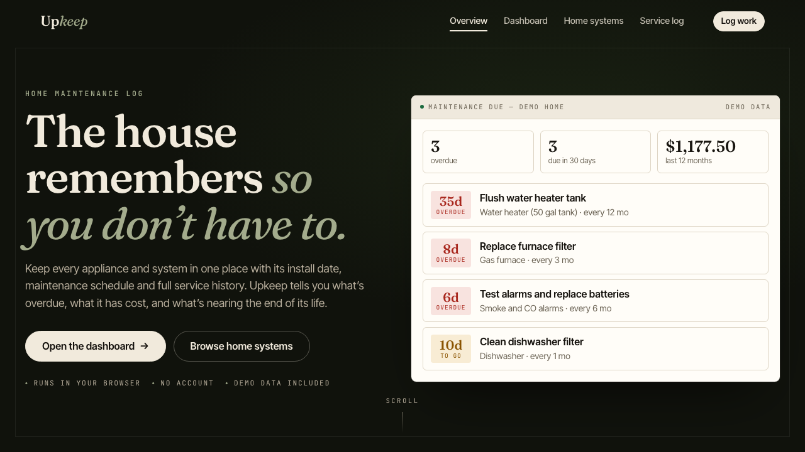
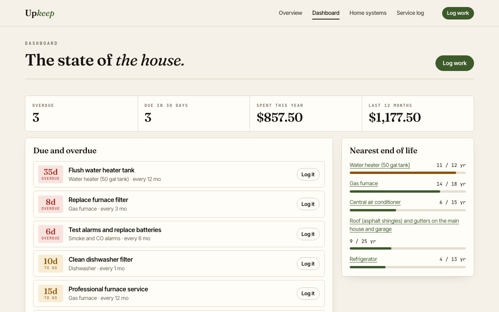
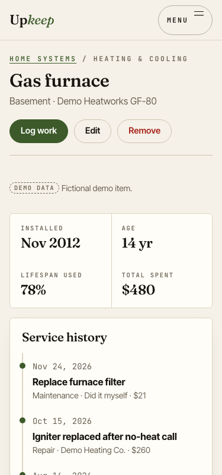

# Upkeep

A home maintenance log for every appliance and system: install dates and expected lifespans, recurring maintenance with due dates, a full service history with costs, and a dashboard of what’s due and what it has cost.

**Live demo:** [https://upkeep-log.vercel.app/](https://upkeep-log.vercel.app/) — runs entirely in your browser; demo data is fictional and labelled.



| Dashboard | Mobile |
| --- | --- |
|  |  |

## Run it

```bash
npm install
npm run dev        # http://localhost:5204
npm test
npm run build
npm run test:e2e   # Playwright smoke test (npm run e2e:install once if Chromium is missing)
```

## Main workflow

1. The app opens with a labelled **demo home**: eight systems (one with a very long name, one with no install date), eight recurring tasks and a year of service history. **Home systems → Clear demo home** removes it.
2. **Home systems → Add item** → name, category, location, brand, model, install date and expected lifespan.
3. On an item’s page, add **recurring tasks** (“every N months”, first due date) and see its age, lifespan used, total spent and service timeline.
4. **Log work** (from the header, a due task or an item) → date, type, cost, who did it and what was done. Linking it to a recurring task moves that task’s next due date.
5. **Dashboard** → overdue and next-30-day work, items nearest the end of their lifespan, spend per month for 12 months and spend by category.
6. **Service log** → search, filter by type and year, sort, paginate, see the total for what’s shown, and export CSV.

## Rules

- A recurring task is due N months after the last time it was logged, or on its first due date if never logged. Month arithmetic clamps to month end.
- Overdue = before today; “soon” = within 30 days.
- Age uses 365.25-day years. Lifespan used = age ÷ expected lifespan; 80% and over shows “Near end”, 100% and over “Past lifespan”.
- Work can’t be logged in the future. Costs default to 0 and are rounded to cents.

## Design

Shared editorial system: Fraunces display type, Inter Tight interface text, mono labels, urgency shown by colour and by the number of days, an ink hero whose preview is the real due list, and a warm paper workspace. Charts have axes in dollars, legends and tooltips on hover or keyboard focus. Motion is disabled under `prefers-reduced-motion`.

## Tests

- `src/lib/upkeep.test.ts` — due dates from the last service, due states, sorting, age and lifespan, monthly and category spend, totals, validation.
- `src/App.test.tsx` — dashboard content, logging scheduled work, record validation, adding an item and a schedule, service-log filter and total.
- `e2e/smoke.spec.ts` — landing, dashboard, log work from a due task with reload persistence, add an item, search the log, plus 375px layout checks.

## Limitations

- No reminders, photos or receipts.
- Single currency (US dollar formatting).
- Lifespans are user estimates, not manufacturer data. Upkeep gives no safety or repair advice.

## Future improvements

- Attach photos and manuals; seasonal checklists.

## Licence

MIT — see [LICENSE](LICENSE).
